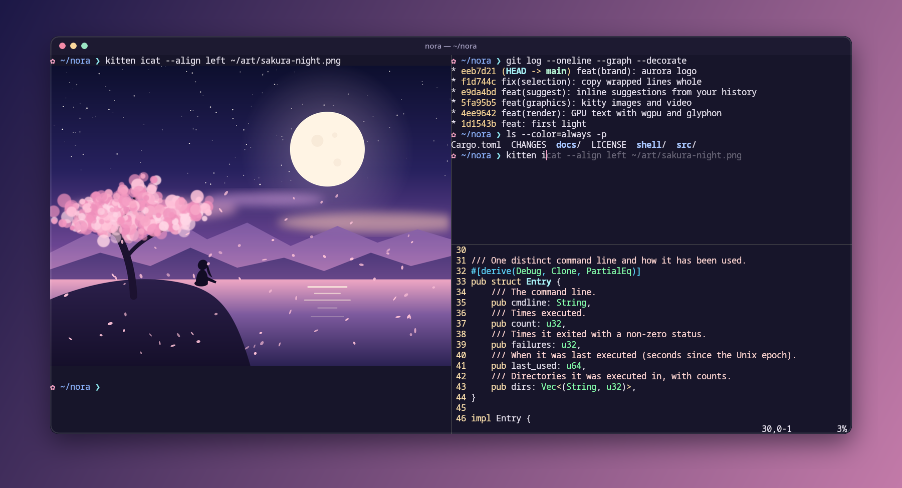

# nora

[](https://github.com/Yejashi/nora/actions/workflows/ci.yml)
[](LICENSE)
[](https://www.rust-lang.org)

A GPU-accelerated terminal for Linux, written in Rust, with inline command suggestions.



nora is a desktop terminal emulator for native Wayland and X11. It aims to
be correct first and fast second: every keystroke and byte of output goes
through in order, memory and queues are bounded, the window sleeps when
nothing changes, and every feature listed here has a test that drives a
real window.

Its distinctive feature is **shell-cooperative autocomplete**. Your shell
reports what you are typing, and nora suggests the rest of the line from
your own command history, ranked by frequency, recency, the current
directory and past failures. The suggestion appears as dim text, and
Right types it. Because the shell's line editor is the source of truth,
suggestions stay correct through history recall, Tab completion and
kill/yank, which a terminal that guesses from the screen gets wrong.

> **Status: early (0.1, pre-release).** Linux is the supported platform.
> macOS and Windows builds pass their tests in CI but have not been used
> interactively. Expect rough edges; see [Limitations](#limitations).

## Contents

- [Features](#features)
- [Install](#install)
- [Usage](#usage)
- [Configuration](#configuration)
- [Shell integration and suggestions](#shell-integration-and-suggestions)
- [Performance](#performance)
- [Limitations](#limitations)
- [Contributing](#contributing)
- [Security](#security)
- [Acknowledgements](#acknowledgements)
- [License](#license)

## Features

- **Native Wayland and X11.** GPU rendering through wgpu (Vulkan, with a
  GL fallback). Nothing is redrawn while idle, and only changed cells
  are rebuilt.
- **Tabs and splits.** A tab bar appears once there is more than one tab.
  Panes are separated by a thin line, and clicking a pane focuses it.
- **Scrollback and search.** 10 000 lines by default. Search covers the
  scrollback and the screen.
- **Inline suggestions** from your history, else an unambiguous path or
  command-name completion (zsh; see
  [below](#shell-integration-and-suggestions)).
- **Shell integration.** Jump to the previous prompt, select the last
  command's output, track the working directory, and Ctrl+click
  hyperlinks (OSC 8).
- **Compatible.** xterm key and mouse encodings, the kitty keyboard
  protocol (all five flags), bracketed paste, focus events, true color,
  wide characters with per-glyph font fallback, and a `nora` terminfo
  entry that is a subset of `xterm-256color`. vim, Neovim, tmux and htop
  are exercised in CI.
- **Images.** The kitty graphics protocol: PNG and raw RGB(A) images,
  inline or from a file, drawn at the cursor under or over the text and
  scrolling with it.
- **Live configuration.** One TOML file, validated, applied on save.
  Covers fonts, colors, cursor, scrollback and key bindings.
- **Bounded and safe by default.** Size caps on control sequences and
  queues. OSC 52 clipboard access from programs is disabled. A clean
  shutdown on SIGTERM, SIGHUP and SIGINT.

## Install

nora is built from source. No packages are published yet.

### Requirements

- Linux with a Wayland or X11 session.
- Rust 1.95 or newer ([rustup](https://rustup.rs) installs the pinned
  1.99.0 automatically).
- A Vulkan driver. Any GPU with one works; Mesa's lavapipe software
  driver works without a GPU.
- A monospace font. nora prefers Noto Sans Mono and falls back to any
  monospace font fontconfig knows. Noto CJK is optional, for wide scripts.

| Distribution | Packages |
| --- | --- |
| Debian / Ubuntu | `build-essential libvulkan1 mesa-vulkan-drivers fonts-noto-core fonts-noto-cjk` |
| Fedora | `gcc vulkan-loader mesa-vulkan-drivers google-noto-sans-mono-fonts google-noto-sans-cjk-fonts` |
| Arch | `base-devel vulkan-icd-loader noto-fonts noto-fonts-cjk` plus your GPU's Vulkan driver |
| NixOS | `noto-fonts noto-fonts-cjk-sans`; the install script handles libraries ([below](#nixos)) |

### Build and install

```sh
git clone https://github.com/Yejashi/nora.git
cd nora
./scripts/install.sh
```

The script builds a release binary and installs it for your user, without
root. It installs:

- `~/.local/bin/nora`;
- the `nora` terminfo entry under `~/.terminfo`;
- a desktop entry and icon;
- an example config at `~/.config/nora/config.toml`, only if you have none.

Make sure `~/.local/bin` is on your `PATH`. `./scripts/uninstall.sh`
removes everything except your config.

To build without installing, run `cargo build --release`. The binary is
`target/release/nora`. To build a single windowing backend:

```sh
cargo build --release --no-default-features --features x11      # X11 only
cargo build --release --no-default-features --features wayland  # Wayland only
```

### NixOS

nora loads Vulkan, Wayland, xkbcommon and the X11 libraries at run time,
and NixOS has no global library path. The install script detects NixOS
and installs a small launcher that points at the right libraries from
the Nix store.

### Remote hosts

Programs on a remote machine need the terminfo entry to know nora's
capabilities. Copy `terminfo/nora.terminfo` there and run:

```sh
tic -x nora.terminfo
```

Without it, set `TERM=xterm-256color` for that session.

## Usage

```sh
nora                         # your login shell in a new window
nora -- htop                 # run a program instead (no shell involved)
nora --working-directory ~/src
nora --hold -- make test     # keep the window open after the program exits
nora --smoke                 # open, draw one frame, resize and exit: checks your GPU setup
```

Run `nora --help` for all options. nora exits with the status of the
program it ran.

### Key bindings

| Action | Keys |
| --- | --- |
| Copy / paste | Ctrl+Shift+C / Ctrl+Shift+V |
| New tab / next / previous | Ctrl+Shift+T / Ctrl+PageDown / Ctrl+PageUp |
| Split right / below | Ctrl+Shift+Enter / Ctrl+Shift+Backslash |
| Focus a pane | Ctrl+Shift+Arrow, or click it |
| Close pane | Ctrl+Shift+W |
| Search | Ctrl+Shift+F, then Enter for the next older match, Shift+Enter for newer, Escape to close |
| Scroll | Shift+PageUp / Shift+PageDown, Shift+Home / Shift+End, mouse wheel |
| Zoom in / out / reset | Ctrl+Shift+Plus / Ctrl+Shift+Minus / Ctrl+Shift+0 |
| Previous prompt / select last output | Ctrl+Shift+Z / Ctrl+Shift+G (with shell integration) |
| Accept suggestion / one word | Right or End / Alt+Right (when a suggestion is shown) |
| Open a hyperlink | Ctrl+click |
| Reload config | Ctrl+Shift+F5 |

Plain Ctrl+letter keys always reach the program, so Ctrl+C, Ctrl+D,
Ctrl+W and the rest behave as usual. A binding with nothing to act on,
such as Right with no suggestion shown, passes its key through too. Every
binding can be changed or removed in the config.

## Configuration

nora reads `~/.config/nora/config.toml` (or
`$XDG_CONFIG_HOME/nora/config.toml`; `--config PATH` picks another). Every
key is optional, and unknown keys are reported as errors so typos are
caught. A small example:

```toml
[font]
family = "JetBrains Mono"
size = 13.0

[colors]
foreground = "#d8dee9"
background = "#1e222a"

[cursor]
style = "beam"

[[keyboard.bindings]]
keys = "ctrl+shift+d"
action = "split_right"
```

| Section | Keys |
| --- | --- |
| `[font]` | `family` (any fontconfig family), `size` (points, default 15) |
| `[colors]` | `foreground`, `background`, `cursor`, `selection_background`; `[colors.normal]` and `[colors.bright]` for the 16 ANSI colors |
| `[window]` | `columns`, `lines`: the initial size in cells |
| `[cursor]` | `style`: `block`, `beam` or `underline` |
| `[scrolling]` | `history` (lines, default 10 000), `multiplier` (lines per wheel step) |
| `[autocomplete]` | `enabled` (default `true`) |
| `[[keyboard.bindings]]` | `keys` (a chord such as `"ctrl+shift+d"`), `action` (an action name, or `"none"` to free a default) |

[`resources/nora.example.toml`](resources/nora.example.toml) documents
every key, its default and every action name.

The file is watched. Saving it applies colors, fonts, the cursor and
bindings to the running window at once; scrollback size applies to new
panes, and window size at the next start. A file with an error keeps the
current settings and shows the error at the bottom of the window. To
check a file without opening a window:

```sh
nora --check-config
```

## Shell integration and suggestions

Shell integration is opt-in. Add one line to your shell's startup file:

```sh
# ~/.zshrc: markers, directory tracking and inline suggestions
source /path/to/nora/shell/nora-zsh.zsh

# ~/.bashrc: markers and directory tracking (no suggestions)
source /path/to/nora/shell/nora-bash.sh
```

| Capability | zsh | bash |
| --- | --- | --- |
| Previous prompt, select last output (OSC 133) | yes | yes |
| Working directory (OSC 7) | yes | yes |
| Inline suggestions | yes | no: plain bash has no per-keystroke hook |

**How suggestions work.** On every redraw of the command line, the zsh
script sends nora the line and the cursor position in an escape sequence
(`OSC 6973`), and when a command runs, the command line and its exit
status. nora suggests from the history of commands you ran. It scores
each one by frequency and recency, triples the score for commands run in
the current directory, and lowers it for commands that failed. With no
match, it completes the last word as a path or command name, but only
when the completion is unambiguous. The suggestion appears only with the
cursor at the end of the line, never in full-screen programs or during a
paste. The encoding runs inside zsh with no process per keystroke, and
other terminals ignore the sequences.

**Privacy.** Everything stays on your machine. The history lives in
`~/.local/state/nora/history` (or `$XDG_STATE_HOME/nora/history`),
readable only by you, capped at 5 000 commands. Commands that start with a
space are never recorded, the same convention as `HIST_IGNORE_SPACE`.
Neither are multi-line commands. Set `enabled = false` under
`[autocomplete]` to turn it off; nora then neither reads nor writes the
file.

The design and its alternatives are in
[ADR-013](docs/adr/ADR-013-autocomplete.md).

## Performance

These figures come from one machine (x86_64, AMD RX 6750 XT with RADV,
GNOME Wayland) unless noted. They are evidence, not guarantees.

| Measure | Result |
| --- | --- |
| Start to first frame | about 180 ms (`nora -- true`: 204–214 ms wall time) |
| Key press to frame presented | about 1 ms median (Xvfb, software GPU) |
| Key press to suggestion on screen | 1.4 ms median, 3.5 ms max (Xvfb, software GPU) |
| Output throughput, 32 MiB with colors | 70–80 MiB/s in the window at 80x24 with 10 000 lines of scrollback (Xvfb, software GPU); with equal scrollback the same as without a window |
| Allocations per frame | about 180 for a full 120x35 screen, 170 for a typed character |
| Idle | no frames drawn; the I/O thread wakes twice a second |

Method and raw numbers are in [docs/performance/](docs/performance/).

## Limitations

- **macOS and Windows are previews.** They build and pass their automated
  tests, but no one has used the window on them yet, and there are no
  installers; work on them is deferred. See
  [docs/15-platforms.md](docs/15-platforms.md).
- **Not supported yet:** font ligatures; kitty graphics animation and
  Unicode placeholders (images themselves are shown).
- **Input methods.** Composition is checked end to end with ibus over
  X11 (preedit, commit, suggestions hidden while composing). fcitx5, the
  Wayland text-input path and the drawing of a candidate window have not
  been checked by a test (the spot nora reports to the input method is).
- **Wayland clipboard.** The clipboard goes through XWayland, so it
  needs XWayland running.
- **Suggestions** need zsh with the integration script.

## Contributing

Issues and pull requests are welcome. For a larger change, please open an
issue first to agree on the approach.

Before sending a pull request, run what CI runs:

```sh
cargo fmt --all --check
cargo clippy --workspace --all-targets -- -D warnings
cargo test --workspace
```

Two more checks:

- **GPU tests** need a Vulkan driver. Mesa's lavapipe is enough; on
  Debian and Ubuntu, select it with
  `VK_ICD_FILENAMES=/usr/share/vulkan/icd.d/lvp_icd.x86_64.json`.
- **Window tests.** `scripts/e2e-x11.sh` drives a real nora window under
  Xvfb, with real key and mouse events. It needs Xvfb, xdotool and
  ImageMagick (zsh, vim, tmux and htop for some scenarios). Run one
  scenario with `scripts/e2e-x11.sh search`.

Guidelines:

- **Behavior changes** come with a test. A bug fix should have a test that
  fails without it.
- **Terminal behavior** comes from [`alacritty_terminal`](https://crates.io/crates/alacritty_terminal),
  vendored in `vendor/` with a small documented patch set; nora does not
  parse escape sequences itself.
- **Design decisions** are recorded as ADRs in [docs/adr/](docs/adr/).
  Architecture, compatibility and resource limits are in
  [docs/](docs/).

| Path | What it holds |
| --- | --- |
| `src/engine.rs`, `src/session/` | Terminal engine adapter, PTY sessions, the I/O thread |
| `src/app/` | Window, input, rendering, panes and tabs |
| `src/input/`, `src/render/`, `src/config.rs` | Key and mouse encoding, colors, configuration |
| `src/suggest.rs`, `src/shell_input.rs`, `shell/` | Suggestions and shell integration |
| `tests/`, `scripts/e2e-x11.sh` | Integration tests and window tests |

## Security

Please report security problems privately through
[GitHub security advisories](https://github.com/Yejashi/nora/security/advisories/new),
not in a public issue.

Programs running in nora are treated as untrusted:

- they cannot read the clipboard (OSC 52 is disabled);
- control sequences are size-capped;
- hyperlinks open only for `http`, `https`, `mailto`, `file` and `ftp`,
  only on Ctrl+click, and through the platform opener with no shell
  involved.

## Acknowledgements

- [Alacritty](https://github.com/alacritty/alacritty)'s `alacritty_terminal`
  (Apache-2.0) is nora's terminal engine: escape-sequence parsing, the
  screen model and the PTY layer.
- [wgpu](https://wgpu.rs), [winit](https://github.com/rust-windowing/winit),
  [glyphon](https://github.com/grovesNL/glyphon) and
  [cosmic-text](https://github.com/pop-os/cosmic-text) provide rendering,
  windowing and text shaping.
- The suggestion design draws on
  [zsh-autosuggestions](https://github.com/zsh-users/zsh-autosuggestions),
  fish's autosuggestions and kitty's
  [shell integration](https://sw.kovidgoyal.net/kitty/shell-integration/)
  protocol.

## License

nora is released under the [MIT License](LICENSE), © 2026 Yejashi.

The vendored `alacritty_terminal` in
[`vendor/alacritty_terminal`](vendor/alacritty_terminal) remains under the
Apache License 2.0 ([its license](vendor/alacritty_terminal/LICENSE-APACHE)).
