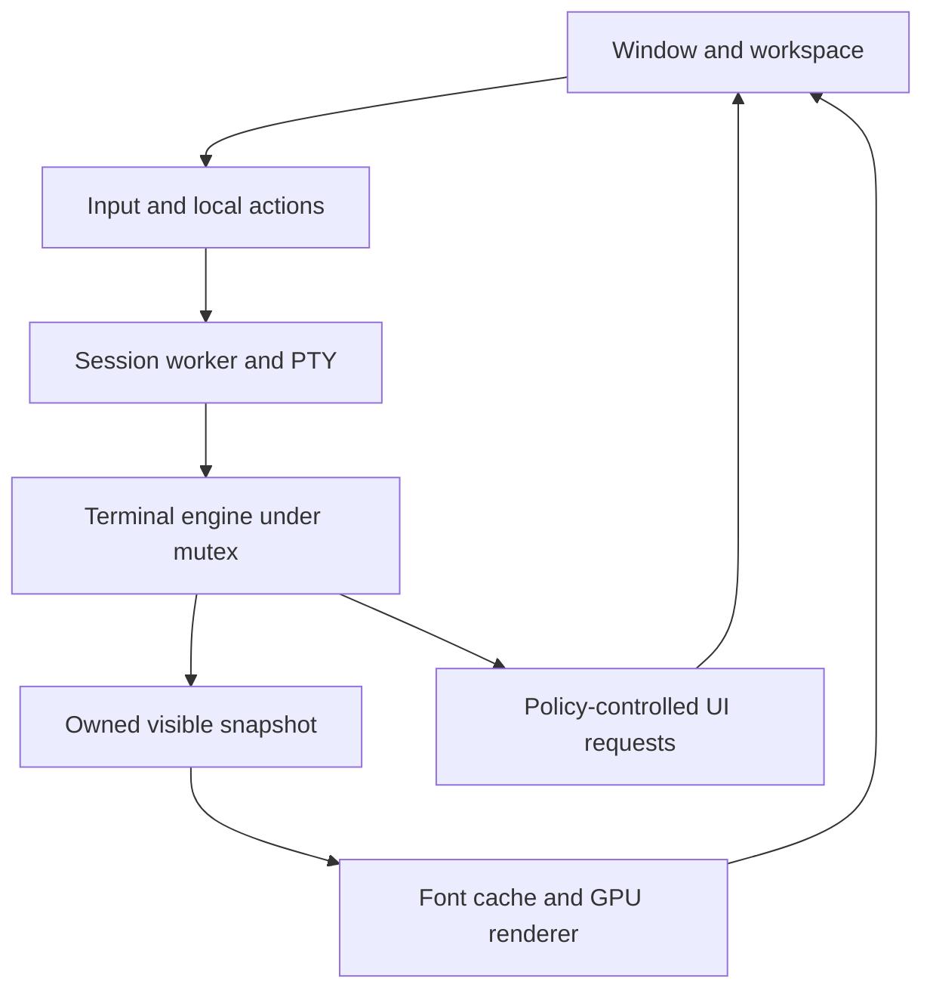

# Architecture and ownership

This is a proposed design. Resolve actual APIs in N01–N03 and record changes in an ADR. Diagrams describe logical boundaries, not separate crates or separate GPU devices.

## Module boundaries

Start with one application crate and internal modules. Add a small `nora-dev` Rust package for benchmark/test helpers once it is needed. Split crates only when a boundary needs independent compilation or testing; avoid a dozen empty crates.

| Module | Owns | Must not own |
| --- | --- | --- |
| `app` | winit lifecycle, event routing, window UI and instance shutdown | VT state mutation logic |
| `workspace` | Tabs, pane tree, focus and integer pixel layout | PTY fd operations |
| `session` | PTY lifecycle, session worker, ordered writes, engine synchronization | GPU resources |
| `engine` | Alacritty adapter, state access, mode mapping, snapshot extraction | Desktop clipboard/URL operations |
| `input` | Key/mouse/focus encoding, paste normalization, local binding resolution | Shell command execution |
| `render` | Font system, cell layout, caches, geometry, GPU device/surface | Shell state or VT parsing |
| `config` | Parse/validate/defaults/reload plan | Implicit execution of config strings |
| `platform` | Clipboard, desktop integration, opening approved URLs, platform diagnostics | Protocol parsing |
| `diagnostics` | Structured timing/counters and sanitized errors | Raw PTY/input recording by default |

## Thread model

- **Main UI thread:** winit window/events; workspace; local actions; snapshot extraction; initially font/render submission. OS event-loop requirements remain here.
- **One I/O worker per pane:** PTY readiness, reads/parser turns, ordered pending writes and lifecycle. Reuse the engine's PTY facilities. Initially use the upstream worker in the feasibility spike; N03 resolves real queue bounds before shipping input.
- **One bounded background worker, added when needed:** search/config/font preparation tasks which would otherwise stall UI. It never holds the terminal lock while doing slow work. Use a fixed pool only if measurements require it.

The terminal is shared under the adapter's `FairMutex` boundary. The I/O worker mutates it during parsing; UI selection, resize and viewport actions also mutate it under that same lock. This is serialized shared ownership, not a claimed lock-free or single-writer model. Only adapter methods can acquire the engine lock.

A dedicated rendering thread is a later optimization trigger, not the first architecture. If surface acquisition or shaping stalls input materially, measure it and move GPU work to a per-window worker while keeping window/platform events on the UI thread. Do not add one renderer/device per pane.

## State and interface contract

Use typed `SessionId`, `PaneId`, `TabId` and generation counters. Events carry a session generation so queued work from an exited/replaced session cannot target a newly created pane. UI owns the pane tree; each pane refers to a session, not vice versa.

Proposed operations are semantic contracts, not assumed upstream method signatures:

| Operation | Contract |
| --- | --- |
| `Session::spawn(LaunchSpec)` | Creates PTY child/worker or returns a contextual error without orphaning resources |
| `enqueue_input(bytes)` | Ordered acceptance; byte-capacity reservation; reports full/closed; accepted data is not dropped |
| `request_resize(size, epoch)` | Latest pending geometry may replace older pending geometry; apply at a defined synchronization point |
| `Engine::snapshot(viewport, cache)` | Copies visible cells, cursor, modes, colors and damage to reusable owned storage |
| `Engine::select/scroll/search` | Serialized engine operations with limited work per call |
| `Session::close()` | Idempotent lifecycle transition; stops new input; closes PTY and reaps the owned child |
| `Renderer::prepare(snapshot)` | No engine reference or terminal lock; cache/geometry updates |
| `Renderer::present()` | Capability-checked surface handling; marks presentation state for diagnostics |

Snapshots carry cell text/combining marks, style, resolved or symbolic color, width flags, hyperlink identity, viewport/geometry epoch, cursor and overlay information. Engine references and borrowed renderable iterators cannot escape the lock scope. Take O(visible cells) snapshots first; optimize measured costs by reusing row buffers and copying changed rows. Never clone the entire scrollback per frame.

## Damage and snapshot retention

Use engine damage for content plus nora-owned invalidation for cursor, selection, search, focus, DPI, palette, atlas rebuild and viewport changes. Upstream damage excludes some UI-controlled elements [S07].

Reset engine damage only after its information/content have been captured into durable renderer-side state while holding the lock. A lost/superseded frame must not lose updates. The initial renderer keeps a complete latest visible snapshot. When snapshots become deltas, use a base revision and require a full rebuild on any mismatch. Do not build an unbounded queue of deltas.

Coalesce redraw wakeups: one pending wake per instance is sufficient, with a race-safe clear/recheck of dirty generations. A PTY event arriving while the UI clears the flag must still schedule work. Do not queue a cloned screen for every parser read.

## Bounded I/O strategy

N03 must inspect the pinned upstream worker. The current inspected source's unbounded channel and pending-write deque [S22] cannot be made bounded by adding a separate bounded queue that forwards without acknowledgements.

Preferred resolution if the pinned API has no end-to-end acknowledgements: adapt the small upstream I/O loop into `session/io.rs`, with source attribution, fixed buffers, a bounded ingress and a pending-write byte budget. Reuse the published PTY/engine types and parser. Verify exposed PTY readiness APIs compile first. This is a scoped I/O adapter, not a fork of the terminal engine. Record upstream revision and maintain a reconciliation note. If public hooks do not suffice, choose a minimal pinned patch or a different engine in an ADR before deeper integration.

Capacity must count queued **plus pending/in-flight application bytes**, not just channel occupancy. Reserve on acceptance and release as writes complete or cancellation/exit discards explicitly. Ordered parser-generated replies join the same writer. Large paste is chunked and only advances when capacity returns. Keep a small reserved control/reply budget so paste cannot prevent queries or shutdown; do not interleave keys into an open bracketed-paste payload. The paste/reply policy is specified in [06-compatibility.md](06-compatibility.md); a reserved budget alone does not solve protocol ordering. Shutdown/resize have a separate bounded control path. Never block the UI to acquire input capacity.

On PTY reads, use finite bytes/time per locked parse turn and service writes/control between turns. If parser callbacks need a full reply queue, retain the bounded unread tail and pause further reads until it drains; no callback may block under the terminal lock. If a protocol event exhausts an enforceable cap, reject it according to protocol or terminate that session with a visible resource-limit error; never continue after silently dropping semantic bytes. N03 tests the chosen recovery strategy with a query flood.

## Initial policy values

These are starting proposals, not established measurements. Validate configurability and accounting in N03/N24.

| Resource | Initial proposal | Overflow/action |
| --- | --- | --- |
| PTY read buffer | 64 KiB reusable buffer | Stop the turn; continue later without truncation |
| Locked parse turn | At most 64 KiB or about 2 ms, whichever comes first | Release lock/service control; timing is best effort |
| Accepted outbound bytes | 1 MiB per session, including pending writes | Backpressure; UI retains bounded paste chunks and indicates pending state |
| Reserved reply/control bytes | 64 KiB per session | Pause parser/read; hard-limit failure is visible |
| View snapshots | Current complete snapshot plus one reusable replacement | Replace presentation state; never lose engine bytes |
| UI protocol-event queue | 256 entries plus 1 MiB total payload | Coalesce replaceable titles/bells; reject capped operations or fail session safely |
| Paste transaction | Up to 8 MiB before any write | Reject larger paste with a user-facing message; no silent truncation |
| Tabs/panes | 32 sessions per instance | Refuse another spawn cleanly |
| Glyph cache | 64 MiB CPU + 64 MiB GPU target per instance | Account actual allocated atlas pages; evict/rebuild at a frame boundary |
| History | 10,000 rows and a target 64 MiB/session | Lower row limit based on geometry/accounting; audit exceptional engine allocations |

Flood audit (N06b) for the protocol-event queue row: the pinned vte parser (`features = ["std", "ansi"]`) accumulates an open OSC payload in an unbounded `Vec<u8>` (`osc_raw`, vte-0.15.0/src/lib.rs:62-64) — bytes are pushed unconditionally while an OSC stays open and the buffer is cleared only at `osc_end` — so a client can hold arbitrary in-flight bytes in the parser before any event exists. Retention after parsing is bounded: the shared `Recorder` keeps at most 256 records and 1 MiB of String-owned bytes (drop-oldest FIFO), with replaceable presentation state coalesced before eviction (latest title wins; a bell while one is pending is skipped). Sub-cap evictions are unaccounted (no `ReplyLedger` rejection); the main thread drains the queue between feeds, so the cap bounds post-parse retention, not in-flight parser bytes.

A row limit does not strictly bound memory when cells can carry extra text or links. Audit parser strings, combining marks, hyperlink storage, history extras and third-party font caches. Enforce caps using supported APIs or a documented minimal patch. If a strict cap is impossible, record the specific exception; do not label it bounded. The resource audit is a release gate, not a fixed-size-of-Cell approximation presented as a guarantee.

## Resize, font and shutdown lifecycle

Derive integer physical pixel cell metrics and pane rectangles from the latest scale/size; minimum usable grid is 2 columns × 1 row. Suspend rendering for a zero-sized/minimized surface; keep the last valid PTY size. Resize terminal/grid and PTY under a documented serialized ordering; tag geometry snapshots with an epoch, then request full damage. TUIs must eventually receive SIGWINCH and agree with nora's grid.

Font/DPI changes create a new font epoch, re-evaluate geometry, rebuild needed caches and invalidate all panes. Old worker results carry an epoch and are discarded if stale. Do not replace a working font until the new choice is validated.

Session lifecycle: `Starting → Running → Exiting → Exited → Closed`; failure transitions include a user-visible reason. Drain finite final output after child exit, reap the owned child once, cancel session work, remove pending events by generation and release resources. Do not wait indefinitely for descendants keeping the slave PTY open. Close the PTY and use the engine's documented lifecycle; any explicit signal targets only the owned child/session, never an unrelated process group. Document finite shutdown/drain timeouts and `--hold` behavior.

## Child-exit lifecycle (N12a)

`PtySession` carries the pinned lifecycle chain `Starting → Running → Exiting → Exited → Closed` (`Lifecycle`, `src/session/pty.rs`): the main thread sets `Running` at spawn (after the loop handle is assigned — the loop thread never sets `Running`) and folds `Exiting` on the first child-exit fold; the session loop thread — a wrapper around the pinned PTY reader — folds `Exiting` on its return path (every exit path of the pinned loop funnels through it, covering a loop death without a child-exit event) and signals its finish; `close()` (main thread only) folds `Exited` after the bounded wait and `Closed` after joining the loop thread. `wait_drain(timeout)` and `DRAIN_TIMEOUT` (5 s) bound every join/close: the pinned `drain_on_exit` read has no in-crate timeout, so finiteness is nora-side. The window pump's terminated arm drains in 10 ms ticks (probe + non-noop snapshot only — no input, no resize) until the loop thread finished, so the final frame renders before `ChildExit`; the stop arm calls `close()` before break — the pinned loop panics in `PeekableReceiver::recv` when its sender is dropped without `Msg::Shutdown` (alacritty_terminal 0.26.0 event_loop.rs:483-488).

## `--hold` (N12b)

`--hold` is a pure UI deferral; it never alters exit-code semantics. Headless: the flag is ignored entirely — no held pane, status propagation unchanged (`run_session` is untouched). Windowed: the `ChildExit` fold captures the status and, when `hold` is set, skips only `event_loop.exit()`; the window keeps its final frame (rendering is pulse-gated — after the pump exits, no `DirtyPulse` arrives, so nothing re-renders). The visible exit status is the NORA_DEBUG `debug: child exit status` line plus the pump's `title:` eprint; there is no dynamic window title in the tree. Unhold/release goes through the existing `CloseRequested` / `Destroyed` / `Quit` arms (no new teardown path), and the exit code is the child status via the existing `child_exit` capture in `app::run_windowed`. Caveat: a window resize while held calls `graphics.set_size` with no follow-up frame (the pump is gone), so the held surface may blank until unhold/close — a held surface is a final frame, not a live session.

## Configuration and logging

Parse TOML into a validated immutable configuration. Reload builds a change plan: colors/keys immediate; font/geometry staged; launch settings for new sessions only. A malformed reload keeps the old config. Store only local diagnostic metadata; raw key/output logs require deliberate development opt-in and must not be committed.
